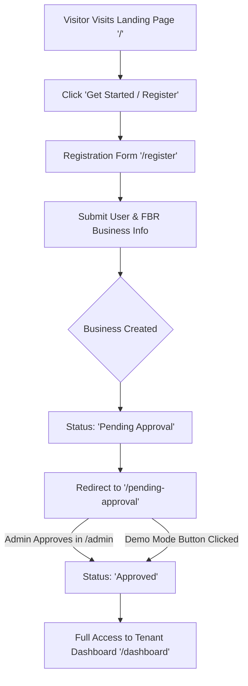
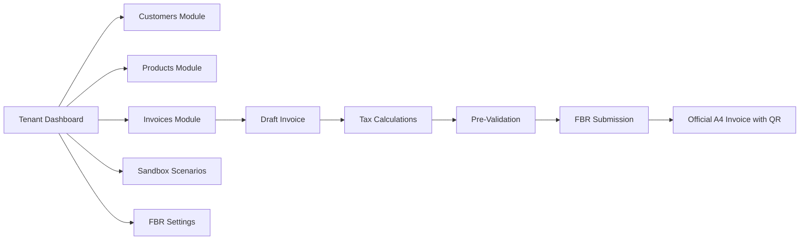
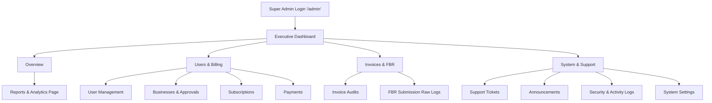

# InvoiceGO — Mukammal System Flow & Architecture Guide
**FBR Digital Invoicing (DI) API v1.12 Compliant Platform**
*Dastaweez baraye: Website (Public), User / Tenant Portal, aur Super Admin Panel*

---

## 📌 Feharist (Table of Contents)
1. [Taaruf (Introduction & Overview)](#1-taaruf-introduction--overview)
2. [Hissa 1: Website & Public Onboarding Flow](#2-hissa-1-website--public-onboarding-flow)
   - 2.1 Landing Page (`/`)
   - 2.2 Business Registration (`/register`)
   - 2.3 Account Approval Lifecycle (`/pending-approval`)
   - 2.4 Authentication & Sign-In (`/login`)
3. [Hissa 2: User / Tenant Portal (Business Operations)](#3-hissa-2-user--tenant-portal-business-operations)
   - 3.1 Tenant Dashboard (`/dashboard`)
   - 3.2 Customer Management (`/customers`)
   - 3.3 Product Management (`/products`)
   - 3.4 Official HS / PCT Codes (`/hs-codes`)
   - 3.5 Complete Invoicing Lifecycle (`/invoices`)
     - Draft Banana (Save as Draft)
     - Real-Time Tax Calculations (GST 18%, Further Tax 4%, Third Schedule)
     - FBR PRAL Pre-Validation
     - Live FBR Submission & Verified QR Code Generation
     - Official A4 Tax Invoice Print / PDF (`/invoices/{uuid}/print`)
     - Bulk Excel / CSV Invoicing (`/invoices/bulk-upload`)
   - 3.6 FBR Sandbox Scenarios Runner (`/sandbox-scenarios`)
   - 3.7 FBR Integration Settings (`/fbr-integration`)
   - 3.8 Tenant Reports & Exports (`/reports`)
4. [Hissa 3: Super Admin Panel (Filament v3 Governance)](#4-hissa-3-super-admin-panel-filament-v3-governance)
   - 4.1 Admin Access & Security (`/admin`)
   - 4.2 Executive Dashboard & Live Analytics
   - 4.3 Users & Business Approvals
   - 4.4 Subscriptions & Payment Verification
   - 4.5 Invoices & FBR Submission Inspection
   - 4.6 Support Tickets & Announcements
   - 4.7 Security & Automated Audit Activity Logs
   - 4.8 System Settings
   - 4.9 Reports & Analytics Page (Light/Dark Mode)
5. [Technical Architecture & Deployment Highlights](#5-technical-architecture--deployment-highlights)

---

## 1. Taaruf (Introduction & Overview)

**InvoiceGO** ek modern, multi-tenant SaaS application hai jo Pakistani businesses ko Federal Board of Revenue (**FBR**) ke official **Digital Invoicing (DI) API v1.12** ke tehat real-time electronic invoicing ki sahulat faraham karti hai.

System ke 3 bunyadi hissay (components) hain:
1. **Public Website:** Naye businesses ki onboarding aur FBR profile registration.
2. **Tenant Portal:** Registered businesses ka operational portal jahan customers, products, drafts, FBR submission, aur printable invoices manage hoti hain.
3. **Super Admin Panel (Filament v3):** Centralized administration jahan platform users, business approvals, subscriptions, payments, audit logs aur FBR submissions monitor hoti hain.

---

## 2. Hissa 1: Website & Public Onboarding Flow

### 2.1 Landing Page (`/`)
- **Brand Presentation:** InvoiceGO ka modern purple (`#5850EC`) hero section, FBR compliance key highlights, live roadmap cards.
- **Onboarding Rail:** Naye users ko 4 steps ka clear roadmap:
  1. Business details register karain.
  2. Sandbox token add karain.
  3. FBR Scenarios run karke qualify karain.
  4. Production invoicing start karain.
- **Quick Links:** Sign In (`/login`), Register (`/register`).

### 2.2 Business Registration (`/register`)
User ko single, elegant split-screen page per register kiya jata hai:
1. **Account Owner Details:**
   - Full Name, Email Address, Mobile Number, Password.
2. **FBR Business Profile:**
   - **Business Legal Name**
   - **NTN / CNIC:** 7-digit NTN (Companies/AOPs) ya 13-digit CNIC (Sole Proprietors).
   - **STRN (Sales Tax Registration Number):** Optional agar sales tax registered ho.
   - **Business Address & Province:** Punjab, Sindh, Khyber Pakhtunkhwa, Balochistan, Islamabad Capital Territory, Gilgit-Baltistan, AJ&K.
   - **Sector & Business Natures:** Manufacturer, Importer, Exporter, Wholesaler, Retailer (Tier-1 POS registration check).
- **Automated Workflow:**
  - Naya `User` create hota hai (`is_super_admin = false`).
  - Naya `Business` record banta hai (`status = pending`).
  - Pivot table `business_user` mein user ko `role = owner` assign hota hai.
  - User automatically sign-in ho kar `/pending-approval` per redirect ho jata hai.

### 2.3 Account Approval Lifecycle (`/pending-approval`)
- Naya business direct dashboard access nahi kar sakta jab tak status `pending` ho.
- **Security Guard (`TenantContextMiddleware`):** Agar koi pending user `/dashboard` ya `/invoices` open karne ki koshish kare, middleware use foran `/pending-approval` screen per rok leta hai.
- **Demo / Local Testing Support:** Screen per ek instant **"Approve Business (Demo Mode)"** button mojood hai jo staging/testing ke liye business ko instantly `approved` status de deta hai. Super Admin panel se bhi ise 1-click approve kiya ja sakta hai.

### 2.4 Authentication & Sign-In (`/login`)
- **Smart Redirection:**
  - Agar user **Super Admin** (`admininvoicego@gmail.com` ya `admin@invoicego.pk`) ho, to login hote hi direct **Super Admin Panel (`/admin`)** per redirect hota hai.
  - Agar user **Tenant Owner/Staff** ho, to verify hota hai ke business `approved` hai. Approved hone per direct **Tenant Dashboard (`/dashboard`)** per bhej diya jata hai.
- **Multi-Business Switcher:**
  - Agar ek user ke paas multiple businesses hon, to sidebar mein mojood dropdown se wo 1-click mein active business switch kar sakta hai (`/switch-business/{uuid}`). Session instantly update hota hai aur data isolation barkarar rehti hai.

---

## 3. Hissa 2: User / Tenant Portal (Business Operations)

### 3.1 Tenant Dashboard (`/dashboard`)
- **Top Business Identity Card:** Active business ka name, NTN, assigned role (Owner/Admin), aur environment badge (`Sandbox only` ya `Production`).
- **Live KPI Stats:**
  - Current Month Total Invoices & Value (PKR).
  - Accepted vs Failed Invoices.
  - Sandbox Qualification Score (out of 28 scenarios).
- **Quick Shortcuts:** Create Invoice, Add Customer, Bulk Upload, FBR Settings.

### 3.2 Customer Management (`/customers`)
- **Registered vs Unregistered Differentiation:**
  - **Registered Buyer:** 7-digit NTN ya 13-digit CNIC lazmi hota hai. System FBR Active Taxpayer List (ATL) status verify karta hai.
  - **Unregistered Buyer:** NTN lazmi nahi hota. Section 3(1A) ke tehat automated 4% Further Tax apply hota hai.
- **Validation Protection:** Agar buyer type "registered" select ho lekin buyer un-registered ho, system explicit error return karta hai: `[Buyer Name] with Registered Error`.

### 3.3 Product Management (`/products`)
- **Catalog Fields:**
  - SKU (Item Code)
  - Canonical Description
  - **HS / PCT Code:** Official 8-digit tariff code.
  - **Unit of Measurement (UOM):** Numbers, KG, Liters, Metric Ton, etc. (FBR compliant list).
  - **Sale Type:** Standard Rate Goods, Reduced Rate (Eighth Schedule), Exempt (Sixth Schedule), Zero-rated (Fifth Schedule), Third Schedule Goods (MSRP basis).
  - **Unit Price** aur **Fixed / Notified Value or Retail Price** (Third Schedule ke items ke liye editable field).
  - Default Sales Tax Rate (default 18%).

### 3.4 Official HS / PCT Codes (`/hs-codes`)
- Official Pakistan Customs Tariff dataset se **6,000+ real HS Codes** system mein seeded hain.
- Searchable live table ke zariye user product add karte waqt exact HS Code search kar sakta hai.

---

### 3.5 Complete Invoicing Lifecycle (`/invoices`)

Invoicing system FBR v1.12 specs ke mutabiq 6 steps per mushtamil hai:

#### Step 1: Create Invoice (`/invoices/create`)
- **Date Protection:** Invoices sirf Pakistan Standard Time ke current calendar month ke andar create ho sakti hain (FBR rule).
- **Searchable Dropdowns (TomSelect):**
  - Customer select karte hi uska NTN, Province, Address aur Registration status auto-fill ho jata hai.
  - Searchable **Buyer Province** dropdown.
  - Line items mein product select karte hi HS Code, UOM, Sale Type, Unit Price aur Tax Rate auto-load ho jata hai.

#### Step 2: Real-Time Tax Calculations
Mathematical accuracy server aur client dono per enforce hoti hai:
$$\text{Sub Total} = \text{Unit Price} \times \text{Quantity}$$
$$\text{Discounted Value} = \text{Sub Total} - \text{Discount Amount}$$
1. **Standard Goods:**
   $$\text{Sales Tax (18\%)} = \text{Discounted Value} \times 0.18$$
2. **Third Schedule Goods:**
   Tax retail price per count hota hai:
   $$\text{Taxable Value} = \text{Retail Price} \times \text{Quantity}$$
   $$\text{Sales Tax} = \text{Taxable Value} \times 0.18$$
3. **Further Tax (Section 3(1A)):**
   Agar buyer **Unregistered** ho, to 4% Further Tax auto-apply hota hai:
   $$\text{Further Tax (4\%)} = \text{Taxable Value} \times 0.04$$
4. **Grand Total:**
   $$\text{Grand Total} = \text{Total Value Excl. Tax} + \text{Sales Tax} + \text{Further Tax} + \text{FED} + \text{Extra Tax}$$

#### Step 3: Save as Draft (`formnovalidate`)
- User kisi bhi waqt form ko incomplete halat mein bhi **"Save as Draft"** kar sakta hai.
- System browser validation ko bypass karke draft save karta hai taake user ka kaam zaya na ho. Draft invoice ko baad mein edit ya delete kiya ja sakta hai.

#### Step 4: Real-Time Pre-Validation (`/invoices/validate-draft`)
- Draft submit karne se pehle **"Validate with FBR Rules"** button click karne per backend background AJAX call karta hai.
- FBR DI API v1.12 ke tamam 20+ checks perform hote hain: HS code format, SRO eligibility, further tax logic, date constraints, rate bounds.
- Agar koi ghalti ho to modal mein user-friendly Roman/English message show hota hai.

#### Step 5: Live FBR Submission (`/invoices/{uuid}/submit`)
- User jab **"Submit to FBR"** click karta hai:
  1. System FBR endpoint (`https://gw.fbr.gov.pk/im/v1/...`) per signed JSON payload bhejta hai.
  2. FBR API validation pass hone per official **FBR Invoice Number** (maslan `6110196137679DIABSXED179925`) aur verification link return karta hai.
  3. Invoice lock ho jati hai (`status = accepted`), ab ise edit ya delete nahi kiya ja sakta.
  4. System QR code payload generate karta hai.

#### Step 6: Official A4 Tax Invoice Print / PDF (`/invoices/{uuid}/print`)
Invoice ka layout official FBR template ke 100% mutabiq render hota hai:
- **Header:** Digital Invoicing Logo, Invoice Reference, Date, aur Green Box mein official **FBR Invoice Number**.
- **Seller & Buyer Info Cards:** CNIC/NTN, STRN, Province, Address, Registration Status.
- **Multi-Tier Line Item Table:**
  - Row 1: Item #, HS Code, Description, Qty, UOM, Unit Price, Sub Total, Discount, Total Value (Excl. Tax).
  - Row 2: Tax Breakdown: Sale Type, SRO #, Taxable Value (MSRP), GST %, Further Tax %, FED, Extra Tax, Total Tax, Total + Tax.
- **Bottom Left: Official FBR Verified Box:**
  - Green border container with **FBR VERIFIED INVOICE** header.
  - Official **FBR DIGITAL INVOICING SYSTEM** badge.
  - Scannable dynamic QR Code jo FBR portal verification link per redirect karta hai.
- **Bottom Right:** Total Excl. Tax, Total GST, Total Further Tax, Grand Total bar (solid blue `#0F3B82`), aur Amount Due bar (soft red).

#### Step 7: Bulk Excel / CSV Upload (`/invoices/bulk-upload`)
- User pre-formatted sample CSV template download karta hai.
- Ek waqt mein sainkdon (hundreds) invoices upload kar sakta hai.
- Option mojood hota hai: "Save all as drafts" ya "Submit all directly to FBR".

---

### 3.6 FBR Sandbox Scenarios Runner (`/sandbox-scenarios`)
- FBR IRIS production token hasil karne ke liye taxpayers ko **28 technical scenarios** pass karna lazmi hota hai.
- Platform mein tamam 28 scenarios seeded hain:
  - `SN001`: Standard Rate Goods Supply (18%)
  - `SN002`: Reduced Rate Supply (Eighth Schedule)
  - `SN003`: Unregistered Buyer with 4% Further Tax
  - `SN004`: Exempt Supply (Sixth Schedule)
  - `SN005`: Zero-Rated Exports (Fifth Schedule)
  - `SN010`: Third Schedule Goods (Retail / MRP Basis)
  - `SN014`: Extra Tax on Specially Notified Goods
  - `SN026 - SN028`: Tier-1 Retail POS Integration, Digital Payment, & Returns
- User har scenario ko directly platform se run karke test kar sakta hai aur live compliance report dekh sakta hai.

### 3.7 FBR Integration Settings (`/fbr-integration`)
- **Credential Storage:** FBR IRIS se mile huye Sandbox aur Production tokens server per AES-256 encrypted store hote hain.
- **Environment Switch:** Sandbox verification complete hone ke baad user Production toggle on karta hai.

### 3.8 Tenant Reports & Exports (`/reports`)
- Monthly sales tax returns summary, monthly invoice volume, output tax breakdown, aur Excel/CSV exports.

---

## 4. Hissa 3: Super Admin Panel (Filament v3 Governance)

Super Admin panel **Filament v3** per mabni hai aur iska visual look Tenant Portal ke purple branding (`#5850EC`), Inter font aur clean rounded layout ke sath 100% matched hai.

### 4.1 Admin Access & Security (`/admin`)
- **Strict Role Gatekeeper:** Sirf wo users jin ka `is_super_admin = true` ho panel access kar sakte hain (`canAccessPanel()` verification). Aam users redirect ho jate hain.
- **Session Stability:** Session race-conditions aur repeated logouts ko khatam karne ke liye optimized session driver use kiya gaya hai.

### 4.2 Executive Dashboard & Live Analytics
- **Live Metric Widgets:**
  - Total Registered Users & Active Accounts.
  - Active vs Expired Subscriptions.
  - Total Platform Invoices Created vs FBR Accepted Invoices.
  - Monthly & All-Time Revenue (PKR).
- **Recent Platform Invoices Widget:** Tamam businesses ki taaza tareen invoices ka live status table.
- **Recent Platform Activities Widget:** Real-time audit log stream.

### 4.3 Users & Business Approvals (`Users & Billing` Group)
1. **User Management (`/admin/users`):**
   - Platform ke tamam operators aur owners ki list.
   - User ko **Active** ya **Suspended** karna. Suspended user foran platform se logout ho jata hai.
   - Super Admin status toggle.
2. **Businesses & Approvals (`/admin/businesses`):**
   - Naye registered businesses ki verification.
   - 1-Click **Approve** ya **Reject** actions.
   - Business ka environment toggle (Sandbox vs Production).
3. **Subscription Management (`/admin/subscriptions`):**
   - Har business ka active subscription plan, billing start date, expiry date (30-day billing cycle).
   - Auto-renew status aur renewal tracking.
4. **Payment Management (`/admin/payments`):**
   - Bank transfer receipts, transaction references (e.g. `TXN-INVGO-202601`), payment status (Successful, Pending, Failed).
   - Admin verification action with timestamps.

### 4.4 Invoices & FBR Submission Inspection (`Invoices & FBR` Group)
1. **Invoice Management (`/admin/invoices`):**
   - Platform-wide cross-tenant invoice repository.
   - Filters: By Business, FBR Status (Accepted, Draft, Failed, Needs Reconciliation), Date range.
   - View complete invoice details and printable view.
2. **FBR / PRAL Integration Logs (`/admin/fbr-submissions`):**
   - Deep diagnostic debugging tool:
     - Raw JSON request payload jo FBR ko bheja gaya.
     - Raw JSON response jo FBR server ne return kiya.
     - HTTP Status code, response time, error codes.

### 4.5 Support Tickets & Announcements (`System & Support` Group)
1. **Customer Support (`/admin/support-tickets`):**
   - Users ke submit kardah support queries.
   - Priority categorization (High, Medium, Low), Category (FBR Integration, Billing, Bug).
   - Admin direct reply interface.
2. **Announcements & Alerts (`/admin/announcements`):**
   - Platform-wide banner broadcasts (maslan "FBR API maintenance scheduled tonight").
   - Active dates aur announcement status.

### 4.6 Security & Automated Audit Activity Logs (`/admin/activity-logs`)
- Har ahem platform event automatically capture hota hai:
  - User Logins & Logouts (with IP Address).
  - Business Registrations & Approvals.
  - Invoices Created, Updated, Deleted, ya FBR Submitted.
  - Bulk Excel Uploads.
  - Customer / Product Changes.
  - FBR Sandbox Scenario Executions.
- Audit trail ko date, actor, business, aur action type ke sath filter kiya ja sakta hai.

### 4.7 System Settings (`/admin/system-settings`)
- Application ke global configuration parameters:
  - Platform Name & Tagline.
  - FBR Sandbox & Production Gateway URLs.
  - API Timeout values.
  - Company Bank Name, Account Title, aur IBAN baraye subscription fee.

### 4.8 Reports & Analytics Page (`/admin/reports-page`)
- **Streamlined Layout:**
  - 4 High-contrast metric cards: User Registrations, Subscription Status, Revenue, FBR Acceptance Rate.
  - Proper `24px` card padding (kisi bhi resolution per numbers border se chipakte nahi hain).
  - User-wise business invoicing breakdown table.
  - **1-Click Theme Switcher:** Light Mode, Dark Mode, aur System default toggle.
  - **Export User Report (CSV):** Platform business summary CSV export.

---

## 5. Technical Architecture & Deployment Highlights

| Feature | Implementation Detail |
| :--- | :--- |
| **Framework** | Laravel 12.x (PHP 8.2+) |
| **Admin Panel Engine** | Filament v3 (Tailwind CSS, Alpine.js, Livewire 3) |
| **Tenant Frontend** | Bootstrap 5.3 + Custom InvoiceGO Design System (`invoicego.css`) + TomSelect |
| **Database Support** | MySQL (Local / Laragon) & Pre-Seeded SQLite (Vercel Serverless) |
| **Data Isolation** | Multi-tenant single-database scoping via `BelongsToTenant` trait & `TenantScope` |
| **FBR Specification** | Official PRAL Digital Invoicing API v1.12 Compliance |
| **Vercel Serverless Engine** | Pre-bundled 1.08MB SQLite database copy on cold start (0.002s response time) |
| **Automated Testing** | 30 Comprehensive Feature & Unit Tests covering all modules |

---

## 🔑 Default Platform Credentials (Reference)

- **Super Administrator:**
  - **Email:** `admininvoicego@gmail.com` *(ya `admin@invoicego.pk`)*
  - **Password:** `AdminPass123!`
  - **Portal:** `/admin`

- **Demo Tenant User (Business: OC1):**
  - **Email:** `nomanoc1a@gmail.com`
  - **Password:** `Password123!`
  - **Portal:** `/login` -> `/dashboard`

---
*Dastaweez tayyar kardah: InvoiceGO Engineering Team*
